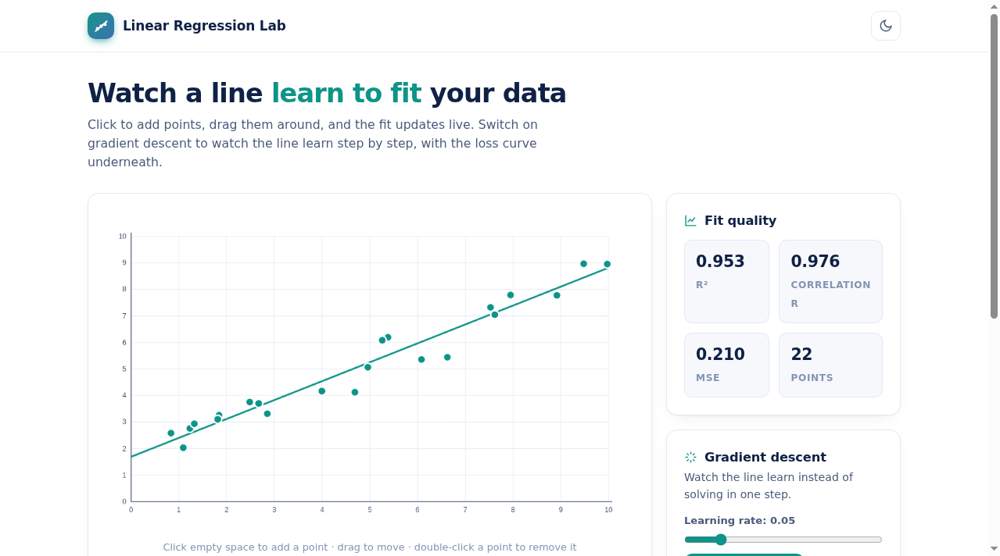
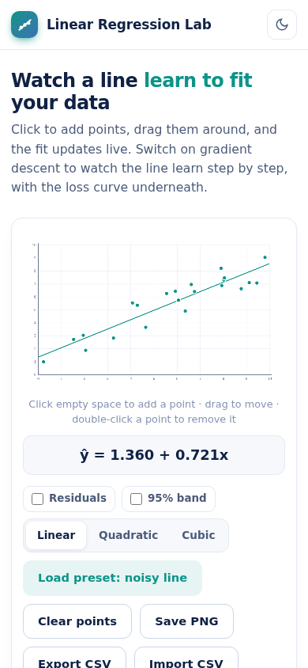

# Linear Regression Lab

An interactive playground for understanding regression. Place points on the canvas, and least squares fits a line instantly; or flip on gradient descent and watch the line learn step by step with its loss curve underneath.

**Live demo: https://akash991833.github.io/linear-regression-lab/**



## Features

- **Interactive canvas** - click to add points, drag to move them, double-click to delete. The fit updates on every change.
- **Exact least squares** for linear, quadratic and cubic fits via normal equations with Gaussian elimination.
- **Gradient descent mode** - start the line from random parameters and watch it converge. Learning-rate slider, single-step mode, live loss curve, iteration counter.
- **Fit quality panel** - R-squared, correlation coefficient r, MSE and point count, updated live.
- **Residual lines and a 95% confidence band** you can toggle.
- **Presets** (noisy line, strong curve, outliers, two clusters) plus CSV import and export, and PNG chart export.
- **Dark and light mode**, mobile-friendly touch dragging.
- **PWA**: installable, fully offline after first load.



## Honest limits

Fits are plain least squares on the points shown. R-squared near 1 means a strong pattern in your sample, not causation, and polynomial fits on few points can overfit.

## Tech

Vanilla HTML/CSS/JS with a hand-rolled canvas renderer. No libraries, no build step, no network calls.

## Run locally

```bash
python3 -m http.server 8000
# http://localhost:8000
```
